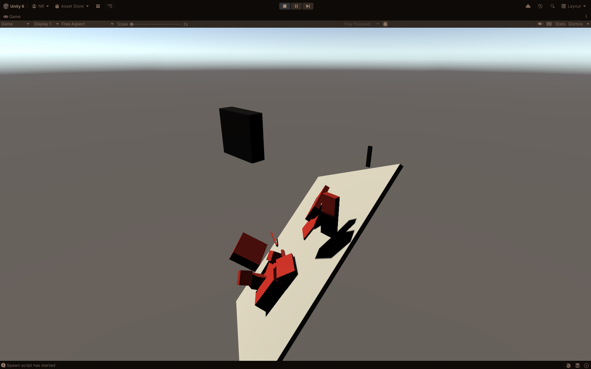
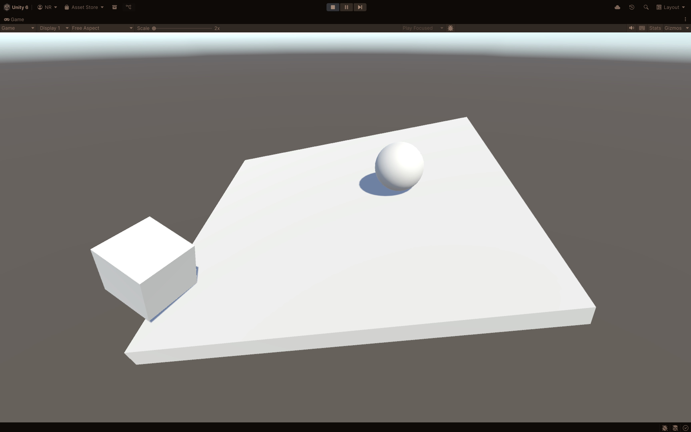

# Forest Game Unity

This repository is a Unity project for the formative assessment. The Unity project files (`Assets`, `Packages`, and `ProjectSettings`) are at the repository root.

## Overview

The task is to reconstruct the falling blocks and hinged platform scene demonstrated in Session 5.

- Blocks spawn at regular intervals above the platform at random X/Z positions.
- Blocks start black and turn red when they hit the platform.
- Blocks are destroyed after falling a set distance.

The project includes a platform, scene objects that drop when the scene starts, and scripts for the exercise. Configure the scripts in the Unity Inspector as needed.

Concepts used in this exercise:

- Physics from Session 4
- Object self-colouring from Session 2
- Spawning from Session 5
- Collision detection, covered in the Session 5 slides

## Open in Unity

1. Clone this repository.
2. Open the repository root in Unity `6000.2.8f1` or later. Earlier Unity 6.2 versions may work, but are not guaranteed.
3. Commit and push your changes to this repository.

## Stretch goal

Make falling objects turn black only when they collide with each other, and red when they collide with the platform.

We'll do a peer review of progress via each other's Git repositories in Session 6.
